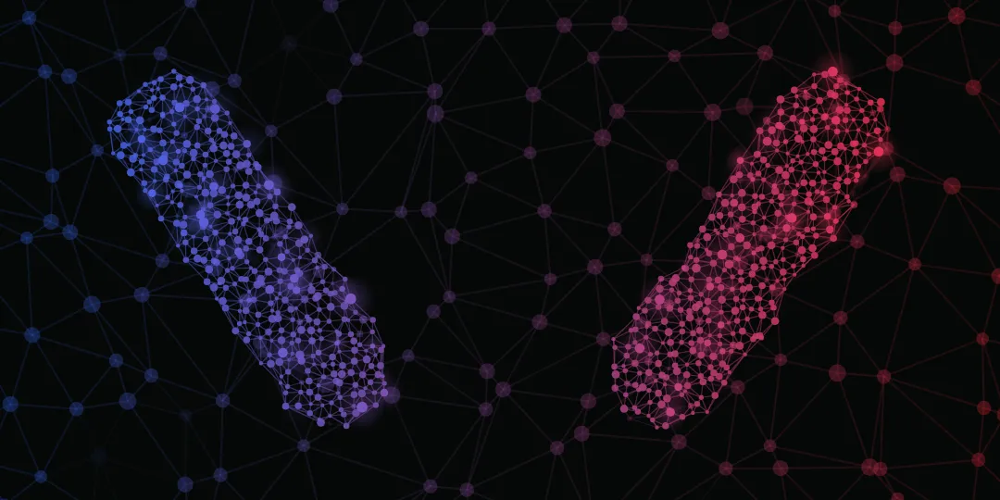

<p align="center">
  <a href="https://rmakowiecki.github.io/Morpheus/">
    
  </a>
</p>

# Morpheus

**An animated graph for Compose that morphs from one shape to another.** One modifier puts a living graph of
nodes and edges behind your content; change its spec and it reshapes in place, with comets carrying the light
across.

[**Live demo**](https://rmakowiecki.github.io/Morpheus/) · runs in your browser, no install

> **Viewer discretion is advised.** Some samples have bright, fast-moving lights and rapid changes in brightness,
> which can trigger seizures in people with photosensitive epilepsy. The gallery's Pause button stops any sample.

- **Morphs.** A graph turns into another one without a cut. Specs of one morph family keep every node in place
  and only reshape and recolor.
- **Shapes.** Pills, ribbons, blooms, rings, rects and triangles, alone or combined, on as many layers as you like.
- **Fills.** Solid, linear and radial fills that blend through a morph, or any `Brush`, shaders included.
- **Comets.** Bright heads carry light from the old shape to the new one while a morph runs.
- **Compose only.** `:morpheus` depends on the Compose runtime, UI and animation, nothing else.

## Quick start

Nothing is published yet, so add this repository as a git submodule and include it as a composite build:

```shell
git submodule add https://github.com/rmakowiecki/morpheus.git morpheus
```

```kotlin
// settings.gradle.kts
includeBuild("morpheus")
```

```kotlin
// a module's build.gradle.kts
implementation("com.rossomak:morpheus")
```

Gradle substitutes the coordinates with the included project. Once the modules are published, drop the
`includeBuild` line and the submodule, and add a version. Keep your build on the Kotlin, AGP and Compose
Multiplatform versions in [`gradle/libs.versions.toml`](gradle/libs.versions.toml), so the composite build
resolves one of each.

**Platforms:** Android 8.0+ (API 26), desktop JVM, and the browser (wasm, needs a browser with WebAssembly GC).
There is no iOS target yet.

### A graph behind your content

```kotlin
@Composable
fun QuickStartSample(modifier: Modifier = Modifier, spec: MorpheusGraphSpec = MorpheusGraphPresets.glowConstellation) {
    Box(modifier.fillMaxSize().morpheusGraphBackground(spec))
}
```

### A graph that morphs

Both specs below are in one morph family, so the nodes stay where they are while the shape changes.

```kotlin
var showBloom by remember { mutableStateOf(false) }
val morph = animateMorpheusGraphMorph(
    target = if (showBloom) MorpheusGraphPresets.MorphFamily.cornerBloom else MorpheusGraphPresets.MorphFamily.ribbon,
    animationSpec = tween(2_000),
)
Box(Modifier.fillMaxSize().morpheusGraphBackground(morph))
```

Flip `showBloom` from anywhere, such as a selected tab, and the graph morphs from wherever it is. Both snippets run under **Start here** in the live demo.

## Modules

| Module | Coordinates | What it is |
| --- | --- | --- |
| `:morpheus` | `com.rossomak:morpheus` | The graph: specs, presets, morphs, fills and the one modifier. Depends only on Compose runtime, UI and animation. |
| `:morpheus-tuner` | `com.rossomak:morpheus-tuner` | A Material3 tuning sheet and playground for designing specs, with export to Kotlin source. |
| `:morpheus-playground` | not published | A desktop app hosting the tuner: `./gradlew :morpheus-playground:run`. |
| `samples` | not published | The live demo as a desktop app (`./gradlew :samples:gallery:run`), and the capture tool behind the hero. |

## How it works

- **A spec describes a graph.** A `MorpheusGraphSpec` is a seed, a list of layers and an optional fill. Each layer
  has its own mesh density, edge rule, glow, node sizes, motion and shapes.
- **Nodes never move, they fade.** A layer is a field of nodes with fixed homes that drift a little. Its shapes are
  density fields over the surface, and a node shows in proportion to the density at its home. Changing a shape
  changes which nodes are present, and the rest fade in and out.
- **Edges come from a rule.** `EdgeRule.Proximity` joins every pair within reach, `FixedTriangulation` triangulates
  once and keeps the edges while nodes drift, and `LivingDelaunay` re-triangulates every frame, fading edges that
  flip. The triangulation is hand-written, not a dependency.
- **A morph switches presence.** Between two specs of one morph family the nodes stay put, presence and fill
  interpolate, and comets carry light from the nodes that leave to the nodes that arrive. A morph can stop, reverse
  and be interrupted part way, and it starts from what is on screen.
- **Drawing is batched.** `Modifier.morpheusGraphBackground` draws every layer back to front with `drawBehind`:
  edges and dots go out in point batches, one native draw call per batch, and the frame loop follows the frame
  clock and pauses below the lifecycle's `STARTED`.

## Project structure

```
morpheus/               the library: specs, presets, engine, morphs, fills and the modifier
  src/commonMain          the engine and API, shared by every target
  src/androidMain         point-batch drawing on Android
  src/skikoMain           point-batch drawing on desktop JVM and the browser
morpheus-tuner/         the tuning sheet and playground, with export to Kotlin source
morpheus-playground/    a desktop app hosting the tuner
samples/
  shared/                 the sample composables and their registry
  gallery/                the live demo, on desktop and in the browser
  capture/                a headless tool that renders samples to WebP and PNG
build-logic/            convention plugins for targets, libraries, samples and static analysis
config/detekt/          detekt configuration
docs/                   the benchmark recipe, design notes, and the README's hero in assets/
scripts/                benchmark runners
.github/workflows/      CI, and the deploy of the live demo to GitHub Pages
```

Guides for each module are coming. Until then:

- [`CHANGELOG.md`](CHANGELOG.md) lists what changed.
- [`docs/benchmark.md`](docs/benchmark.md) measures what a frame costs.
- [`CONTEXT.md`](CONTEXT.md) defines the words used here: graph, spec, layer, shape, preset, fill, morph, morph family and comet.

## Contributing

[`CONTRIBUTING.md`](CONTRIBUTING.md) has the checks to run before a pull request.

## License

[MIT](LICENSE) © 2026 Radosław Makowiecki
