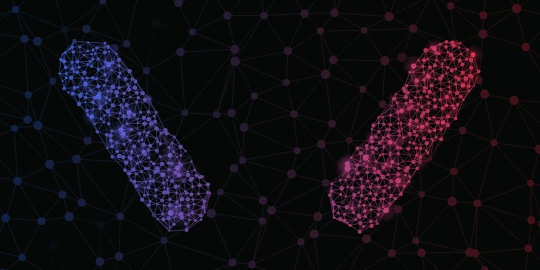

[](https://rmakowiecki.github.io/Morpheus/)

# Morpheus

[Live demo](https://rmakowiecki.github.io/Morpheus/)

Compose Multiplatform eye-candy libraries for Android, desktop JVM and the browser (wasm).

| Module | Coordinates | What it is |
| --- | --- | --- |
| `:morpheus` | `com.rossomak:morpheus` | An animated network-graph background whose specs morph into each other. Depends only on Compose runtime, UI and animation. |
| `:morpheus-tuner` | `com.rossomak:morpheus-tuner` | A Material3 tuning sheet and playground for designing specs, with export to Kotlin source. |
| `:morpheus-playground` | not published | A desktop app hosting the tuner: `./gradlew :morpheus-playground:run`. |

See [ADR-0001](docs/adr/0001-app-agnostic-multiplatform-libraries.md) for the design rules.

## Using it from another build

Nothing is published yet. Add this repository as a git submodule and include it as a composite build:

```shell
git submodule add https://github.com/rmakowiecki/morpheus.git morpheus
```

```kotlin
// settings.gradle.kts
includeBuild("morpheus")
```

```kotlin
// a module's build.gradle.kts
implementation("com.rossomak:morpheus")
```

Gradle substitutes the coordinates with the included project. Once the modules are published, drop the
`includeBuild` line and the submodule, and add a version.

Keep the consumer on the Kotlin, AGP and Compose Multiplatform versions in
[`gradle/libs.versions.toml`](gradle/libs.versions.toml), so the composite build resolves one of each.

## Checks

```shell
./gradlew build staticAnalysis
```
